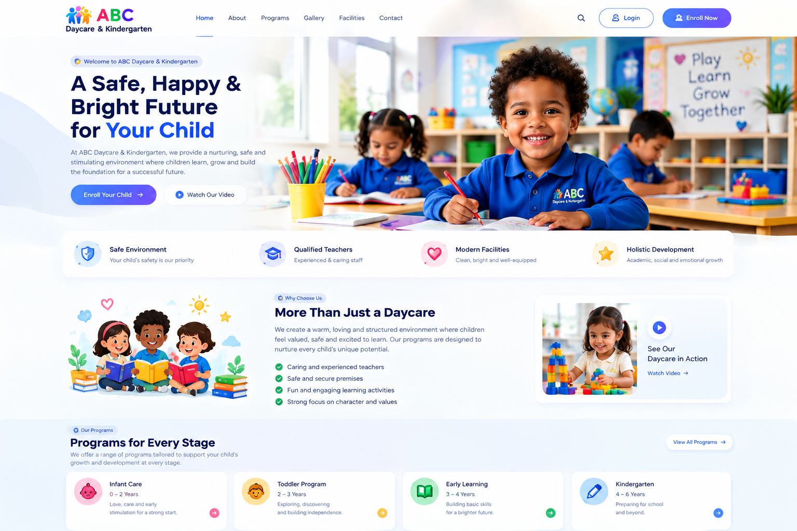
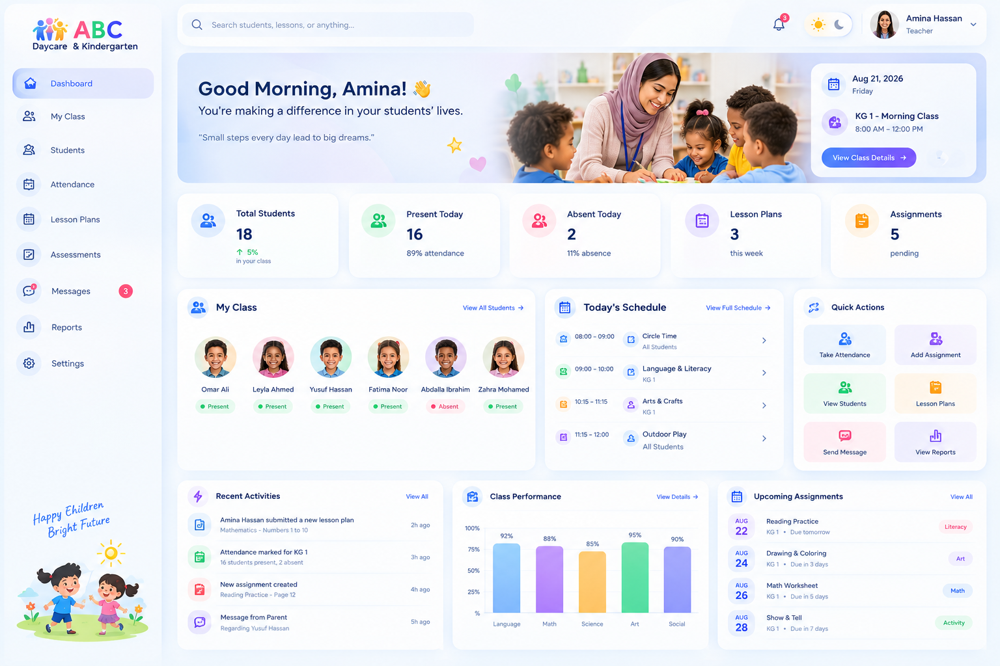
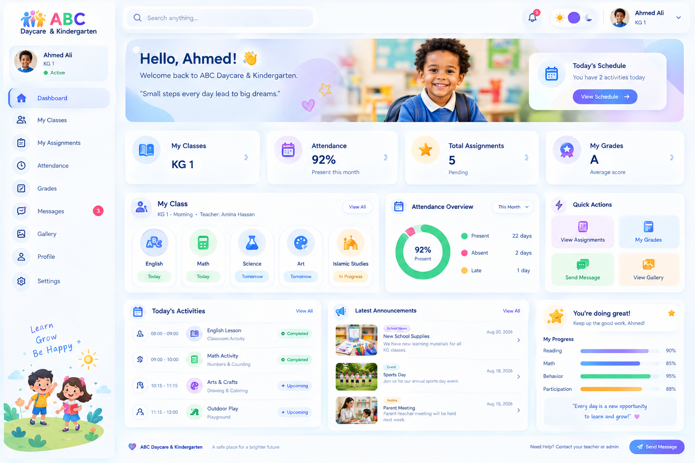
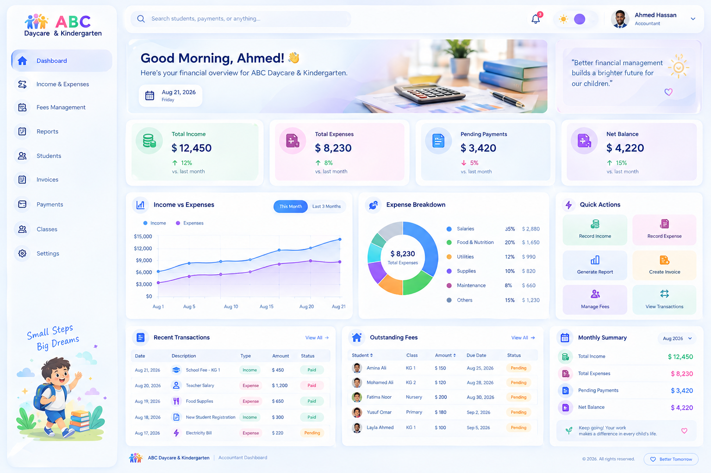
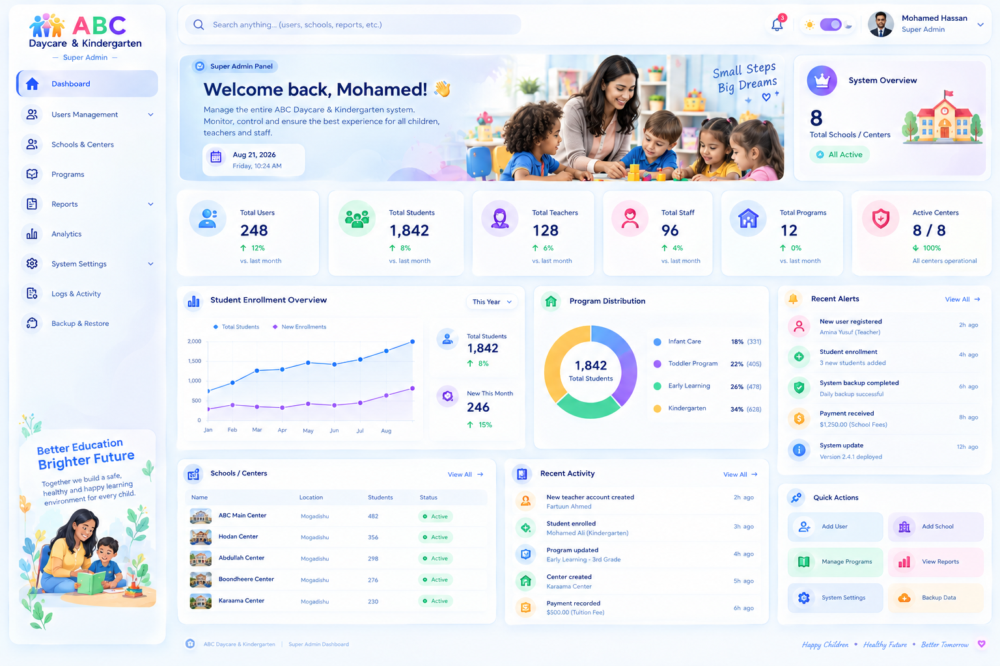

<div align="center">

# 🎓 ABC Daycare & Kindergarten

### A secure, role-based school management platform

Manage students, teachers, attendance, exams, finance, subscriptions, and school operations from one modern workspace.

[](https://react.dev/)
[](https://nodejs.org/)
[](https://expressjs.com/)
[](https://neon.tech/)
[](https://orm.drizzle.team/)
[](SECURITY_REPORT.md)



</div>

## ✨ What is ABC?

ABC is a full-stack management system built for daycares, kindergartens, and schools. It gives every user a focused workspace while keeping school data separated and protected on the server.

| Workspace | What it provides |
| --- | --- |
| 🛡️ **Superadmin** | School oversight, user provisioning, subscriptions, reports, audit logs, and platform settings |
| 🏫 **Administrator** | Students, classes, teachers, academic years, exams, guardians, and daily operations |
| 👩‍🏫 **Teacher** | Assigned classes, attendance, assessments, lesson plans, marks, and reports |
| 👨‍🎓 **Student / Guardian** | Classes, attendance, assignments, grades, messages, gallery, and published results |
| 💳 **Accountant** | Fee plans, invoices, collections, receipts, expenses, payroll, budgets, and closings |
| 📊 **Manager** | School-level operational dashboards, reports, and controlled management workflows |

## 🖼️ Product preview

The images below are UI design previews for the role-based workspaces.

<table>
  <tr>
    <td width="50%"><br/><sub>🏫 Administrator workspace</sub></td>
    <td width="50%"><br/><sub>👩‍🏫 Teacher workspace</sub></td>
  </tr>
  <tr>
    <td width="50%"><br/><sub>👨‍🎓 Student and guardian workspace</sub></td>
    <td width="50%"><br/><sub>💳 Finance workspace</sub></td>
  </tr>
  <tr>
    <td colspan="2"><br/><sub>🛡️ Superadmin workspace</sub></td>
  </tr>
</table>

## 🚀 Highlights

- 🔐 Role-based authentication with server-side authorization on protected routes.
- 🏢 School-scoped records and ownership checks for multi-tenant isolation.
- 🧾 Atomic finance operations for invoices, payments, receipts, refunds, and closings.
- 📝 Complete exam lifecycle: drafts, submission, publishing, rankings, and progression.
- ⚡ Conflict-aware workspace saves that prevent stale updates from overwriting newer data.
- 📱 Responsive React interface with dedicated workspaces for each role.
- 💰 Sifalo Hosted Checkout integration for monthly school subscriptions.
- 🧪 Automated API, frontend, finance, tenancy, and exam-flow tests.

## 🔒 Security by design

Security controls are applied across the frontend, API, database access layer, and deployment configuration:

- Secrets remain server-only; local `.env` files, private keys, certificates, logs, and build output are excluded from Git.
- Passwords are hashed, JWT signing secrets are validated, and account status/role is rechecked on authenticated requests.
- API input is validated, database access is parameterized through Drizzle ORM, and API responses avoid returning password hashes.
- CORS uses an explicit trusted origin, production proxy settings are controlled, and security headers are enabled.
- API-wide and stricter authentication rate limits reduce automated abuse on a single server instance.
- Database operations enforce school ownership and record-level access; finance writes use transactions and immutable audit history.
- Uploaded files are not accepted by the current API, reducing file-upload attack surface.
- Production errors are sanitized and debug details are not exposed to clients.

See the detailed [security implementation report](SECURITY_REPORT.md) for the completed audit, controls, and verification results.

## 🧰 Technology

| Layer | Stack |
| --- | --- |
| Frontend | TypeScript, React 18, React Router, Vite, Lucide icons |
| API | Node.js 22, Express 5, Zod validation |
| Data | PostgreSQL / Neon, Drizzle ORM |
| Authentication | JWT, bcrypt password hashing, server-side role checks |
| Email & billing | Nodemailer, Sifalo Hosted Checkout |
| Quality | Node test runner, PGlite, source and binding checks |

## 📚 Contents

- [Quick start](#-quick-start)
- [Project structure](#-project-structure)
- [API overview](#-api-overview)
- [Sifalo subscriptions](#-sifalo-monthly-subscriptions)
- [Verification](#-verification)
- [Deployment and product limits](#-deployment-and-product-limits)

## ⚡ Quick start

Requires **Node.js 22.12+**. The included `.nvmrc` selects Node 22.

```bash
nvm use
npm install
cp .env.example .env # Only if you do not already have a local .env
```

Set `DATABASE_URL` to your Neon PostgreSQL connection string, `JWT_SECRET` to a random secret of at least 32 characters, and `SEED_ADMIN_PASSWORD` to a password of at least 12 characters. An ignored local `.env` may already contain a generated signing secret; its database URL and seed password are intentionally blank. Never prefix server secrets with `VITE_`.

```bash
npm run db:migrate
npm run db:seed
npm run dev
```

Open `http://localhost:5173`, then sign in using `SEED_ADMIN_EMAIL` and `SEED_ADMIN_PASSWORD`. The API runs on port 5000; Vite proxies `/api` to it. `PORT` changes both the API listener and proxy target. `CLIENT_ORIGIN` must match the browser origin.

The seed is explicitly for an **empty development database**. It creates the configured superadmin without overwriting an account that already uses the same email address. Create and manage additional accounts through Users Management or `/api/users`. Public registration creates an unverified school administrator account; after email verification, the administrator completes plan payment and school onboarding. It does not allow a registrant to select an elevated platform role.

`npm run db:generate` creates SQL migrations after schema edits. `npm run db:push` is available for disposable development databases. Applying migrations to a live database requires its actual connection URL; the repository does not contain Neon credentials.

## 🗂️ Project structure

- `src/app/`: router, authentication, workspace loading/persistence, theme providers.
- `src/components/ui/` and `src/components/layout/`: shared visuals and layout.
- `src/features/{auth,dashboard,admin,teachers,students,finance,superadmin}/`: feature APIs, role controllers, and extracted route sections.
- `src/pages/`: route entry points; role pages delegate to their feature workspaces.
- `src/services/api.ts`: authenticated fetch wrapper and API errors.
- `server/routes/`: authenticated API endpoints and validation.
- `server/db/schema/`: users, students, attendance, invoices, transactions, workspaces, and system audit logs.
- `server/db/migrations/`: generated, committed SQL migrations.
- `server/db/seed.js`: explicit development fixture migration.

Student, user, attendance, invoice, transaction, fee plan, bill, receipt, refund, budget, closing, and finance settings records use relational tables. Lessons, classroom settings, assignments, conversation notes, school/program directories, and migrated read-only content use JSONB workspace payloads. IDs remain text to retain existing fixture references; new accounts and API records use UUID strings.

School records are not stored in localStorage. Browser authentication uses an HttpOnly, SameSite=Strict session cookie, marked Secure in production; the frontend confirms the active session with the server. Theme preference is the only localStorage state. Each workspace loads before its controls render. Saves are atomic; all canonical API writes also advance the school revision. Conflicting writes stop editing and offer a reload, rather than overwriting someone else's records. Failed writes display a persistent error. Wait for saving to finish before closing the tab; there is no offline save queue.

Teachers see assigned students; guardians see linked children and their attendance. Accountants cannot access user administration, and public registration cannot select an elevated role. JWT verification rechecks account status and role on every request. Finance records are scoped to the accountant's school. Invoice payments update the balance, ledger, and receipt in one transaction, reject overpayments, and accept an optional idempotency key for safe retry. Refunds retain the original posting and add a reversing entry. A closed day or month rejects new postings in that period.

## 🔌 API overview

Protected endpoints accept the secure browser session cookie; `Authorization: Bearer <token>` remains available for API clients. Public exceptions—such as health checks, selected authentication steps, billing plans, and verified Sifalo callbacks—are explicitly mounted by the server. Some authentication routes, including account details and onboarding, still require an active session.

| Endpoint | Purpose |
| --- | --- |
| `POST /api/auth/login`, `POST /api/auth/register`, `GET /api/auth/me` | Session login, new school-administrator registration, and current account |
| `GET /api/health` | Check database connectivity |
| `GET/POST /api/users`, `PUT /api/users/:id` | Superadmin account provisioning; passwords are optional, never returned |
| `GET /api/superadmin/users`, `GET /api/superadmin/logs` | User directory and authoritative API audit trail |
| `GET/POST /api/students`, `PUT /api/students/:id` | Scoped directory; administrators can enroll/edit/link accounts and registered classes |
| `GET/POST /api/attendance` | Scoped attendance with one record per student/date |
| `GET/POST /api/academic-years`, `POST /api/academic-years/:id/start` | School-year setup and administrator-confirmed year transition |
| `GET/POST /api/exams`, `GET/PUT/POST /api/exams/assignments/:id/*` | School-scoped exam periods, teacher draft marks, submission and administrator reopen |
| `POST /api/exams/:id/publish`, `POST /api/exams/:id/cancel` | Atomic ranking, publication, promotion/course enrollment, or audited cancellation |
| `GET /api/exams/:id/results`, `PUT /api/exams/:id/results/:studentId/decision` | Published class results and repeat/re-exam decisions |
| `GET/POST /api/exams/:id/courses`, `GET /api/exams/results/me` | Accelerated-course roster and guardian/student published results |
| `GET /api/finance/summary`, `/transactions`, `/invoices`, `/outstanding` | School scoped ledger, receivables, and totals |
| `POST /api/finance/invoices`, `/payments`, `/other-income` | Student charges, atomic collections, and receipts |
| `GET/POST/PUT /api/finance/fee-plans` | Reusable class fee schedules |
| `PUT /api/finance/onboarding`, `POST /api/finance/fee-plans/:id/generate` | First-run class setup and idempotent 1–12 month schedules with one-time fees |
| `GET/POST /api/finance/staff-payments`, `/school-expenses`, `/bills` | Payroll, operating expenses, and vendor bills |
| `POST /api/finance/bills/:id/payments` | Atomic vendor bill payment and expense posting |
| `GET /api/finance/receipts`, `/ledger`, `/audit`, `/reports` | Financial documents, history, and reports |
| `GET/POST /api/finance/refunds`, `/closings`; `GET /closings/preview` | Reversals and daily/monthly close |
| `GET/PUT /api/finance/budgets`, `/settings` | Budget allocations and school receipt settings |
| `GET /api/dashboard/:role` | Role summary |
| `GET/PUT /api/workspace/:role` | Existing role workflows with revision checks |

### 💸 Sifalo monthly subscriptions

New school administrators must activate a monthly plan before school onboarding. Standard is USD 1/month with one active manager and one active accountant; Enterprise is USD 10/month with two of each. Payments use Sifalo Hosted Checkout, so wallet and card details never enter this application. The server activates access only after verifying that Sifalo returned both `status: "success"` and `code: 601`.

Configure `SIFALO_ENV`, `SIFALO_API_USER`, `SIFALO_API_KEY`, and a public `PUBLIC_APP_URL` in `.env`. Start with `.net` staging credentials; live `.com` credentials are separate. Apply migration `0015_sifalo_billing.sql` before enabling the flow. Renewals are manual monthly payments; automatic recurring charging is not assumed.

| Endpoint | Purpose |
| --- | --- |
| `GET /api/billing/plans` | Authoritative prices and seat limits |
| `POST /api/billing/checkout` | Create an authenticated Sifalo checkout session |
| `GET /api/billing/return` | Verify the browser return and open the result page |
| `POST /api/billing/webhooks/sifalo` | Re-verify and idempotently apply callbacks |
| `GET /api/billing/subscription` | Read the administrator's current access |
| `GET /api/billing/payment/:orderId` | Reconcile a pending, owned payment |

## ✅ Verification

```bash
npm run check
npm test
npm run build
```

Tests use embedded PostgreSQL (PGlite) and Node HTTP streams to exercise Express without an external database or network listener. They cover authentication, school isolation, attendance validation, stale writes, exam mark locking, tied rankings, publication, main/re-exam/course promotion, course enrollment, year transition, finance payments and receipts, idempotent retry, payroll duplicates, refunds, budget totals, and period locks. Frontend tests compile and render all role route sections with seeded and empty database payloads, without opening a web server. `npm run check` parses JavaScript/JSX and checks local imports and frontend bindings. The existing design audit scripts remain available.

## 🚢 Deployment and product limits

Build the frontend with `npm run build` and serve `dist/` with SPA fallback. Start the API with `npm start` behind HTTPS. Route `/api` to Express on the same public origin and set `CLIENT_ORIGIN` accordingly. Use a production secret and a separate production database; do not load development fixtures into production.

Conversation replies are persisted notes, not delivered messages. Notification switches do not send email. Historical charts and operational staff dashboards retain imported demonstration content; they are not telemetry. The superadmin workspace export covers its visible directory/program data, not full database recovery; use Neon backups for that. Profile contact preferences do not change account credentials. No email invitation, password recovery, attachment upload, or offline queue is implemented.

Migration `0008_finance_workspace.sql` backfills invoice school ownership from students and transaction ownership from linked invoices or the creator. Migration `0009_finance_ownership.sql` quarantines mismatched legacy links and enforces matching school ownership with composite foreign keys. Legacy rows with no provable school remain unassigned and are not exposed to school accountants; review them before a live migration. If an older database already has the original tables but its `drizzle.__drizzle_migrations` history is empty, `db:migrate` will try to recreate those tables. Back it up and reconcile its schema and migration history before applying `0008`; do not run a blind `db:push`. Financial records are stored in USD. Monthly closing is allowed only after the month ends and all days with posted entries are closed. Posted entries are immutable; there is no reopen operation. Receipts record confirmed collections; they do not transfer money or confirm an external bank/mobile settlement. Attachments and automatic payment reminders are not implemented. Live Neon connectivity and a full authenticated browser walkthrough require an accessible account and are not confirmed merely by a successful build.

Migration `0010_finance_onboarding.sql` adds the school-wide accountant setup state, class-linked annual fee plans, one-time fee definitions, and idempotent invoice schedule keys. After the required password change, an accountant is sent to Finance Setup until setup is complete. Fee plan, onboarding, and finance settings changes appear in the school administrator's notification menu.

Migration `0011_exams_academic_years.sql` adds ordered class progression, academic years, historical class enrollments, official exams, teacher submissions, immutable published results, failed-student decisions, and accelerated-course enrollment. Configure each class's next class/program before publishing a main exam. A class with accelerated courses enabled must have two reachable successors. Apply and review this migration in a disposable database before migrating a live school database.
